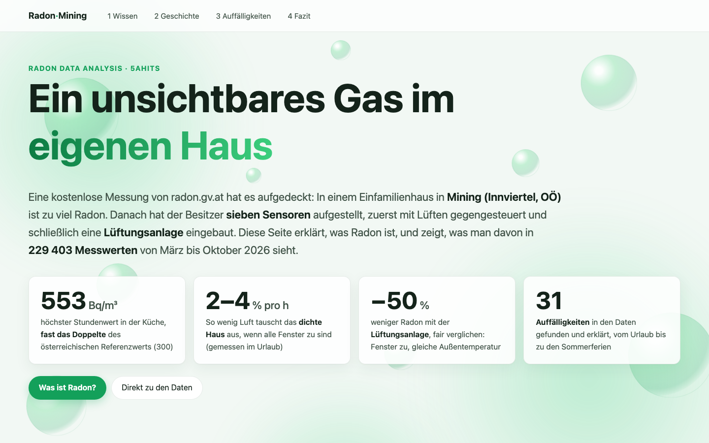

# Radon Data Analysis

**5AHITS · INSY · Aldin Mukic & Lisa Hintermaier**

Auswertung von 229 403 Radon-Messwerten eines Einfamilienhauses in Mining (OÖ), März bis Oktober 2026:
Was ist Radon, wie kommt es ins Haus, was hilft – und was sieht man davon in den Daten?

## 🔗 Ergebnisse ansehen

| | Link |
|---|---|
| 🌐 **Interaktive Website** | **[aldin-122.github.io/5AHITS-INSY-Radon/radon.html](https://aldin-122.github.io/5AHITS-INSY-Radon/radon.html)** |
| 📄 **Dokumentation (Quarto)** | **[aldin-122.github.io/5AHITS-INSY-Radon/dokumentation.html](https://aldin-122.github.io/5AHITS-INSY-Radon/dokumentation.html)** |

> GitHub zeigt große HTML-Dateien im Repo nicht an – bitte die Links oben verwenden.



## Wichtigste Ergebnisse
- **Sehr dichtes Haus:** nur 2–4 % Luftwechsel pro Stunde. Ganz ohne Lüften würde sich das Radon bei ≈ 360 Bq/m³ einpendeln (über dem Referenzwert 300).
- **Lüften** wirkt sofort, aber nur für Stunden. Die **Lüftungsanlage** senkt das Radon bei gleichen Bedingungen um ca. **50 %**.
- **Kamineffekt:** In der Heizzeit war es 5,7-mal so viel wie im Sommer.
- **31 Auffälligkeiten** gefunden und erklärt, z. B. Urlaub, Morgenlüften, Dunstabzug am 20.07., Sensor-Neustarts.

## Selbst ausführen
```bash
git clone https://github.com/aldin-122/5AHITS-INSY-Radon.git
cd 5AHITS-INSY-Radon
python3 analyse.py        # Auswertung → ergebnisse/ergebnisse.json
python3 diagramme.py      # Diagramme → diagramme/
python3 webseite.py       # Website → radon.html (öffnet sich im Browser)
python3 -m unittest -v test_analyse
```
Benötigt: Python 3 mit `pandas`, `numpy`, `scipy`, `matplotlib`.
Die Doku wird mit [Quarto](https://quarto.org) erzeugt: `quarto render dokumentation.qmd`.

## Dateien
| Datei | Inhalt |
|---|---|
| `radon_sample_data.csv` | Messdaten |
| `daten.py`, `analyse.py`, `diagramme.py`, `auffaelligkeiten.py` | Einlesen, Auswertung, Diagramme, Auffälligkeiten |
| `webseite.py`, `webseite_vorlage.html` → `radon.html` | Website (eine Datei, offline lauffähig) |
| `radon_laender.py`, `welt/` | Daten für die Weltkugel (UNSCEAR 2006, Ländergrenzen: world-atlas/Natural Earth) |
| `test_analyse.py` | 20 Tests |
| `dokumentation.qmd` → `dokumentation.html` | Abgabe-Dokumentation |
| `DOKUMENTATION.md`, `RECHERCHE.md`, `PLAN.md`, `PROMPTS.md` | technische Doku, Quellen, Plan, Prompt-Protokoll |
