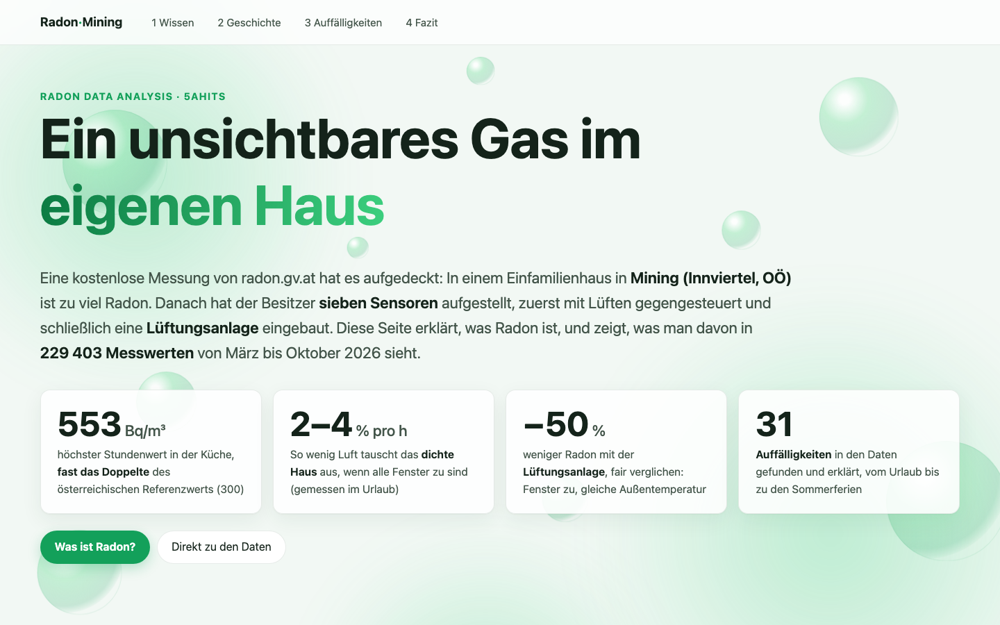
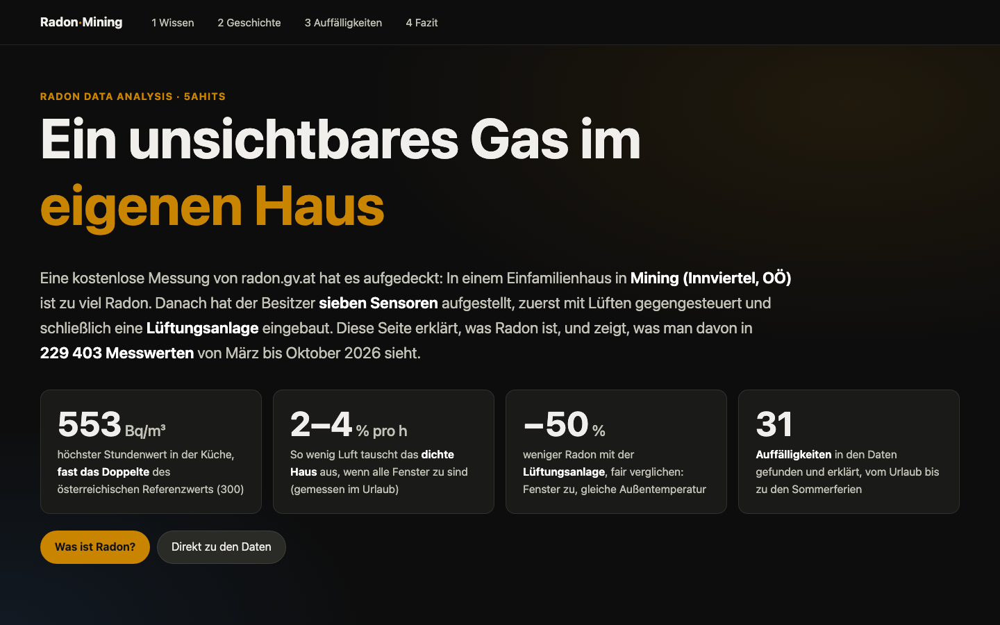
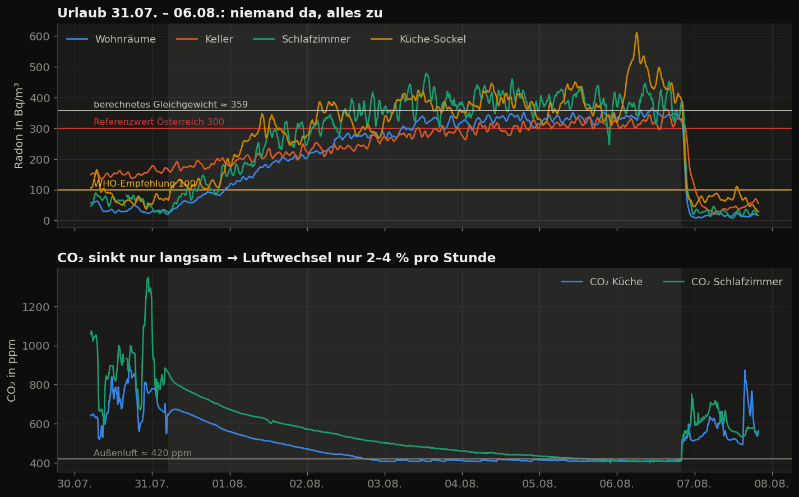
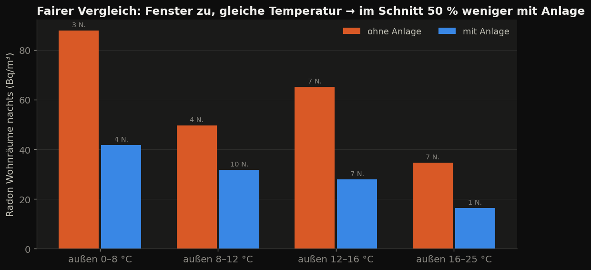
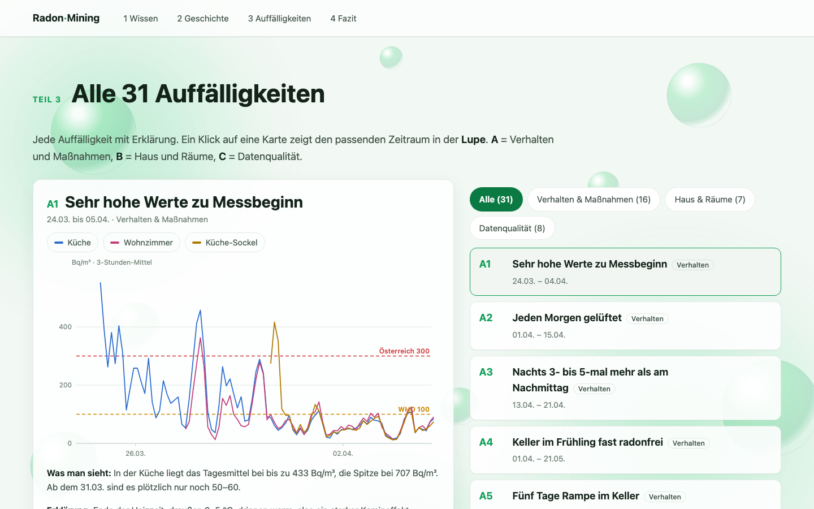
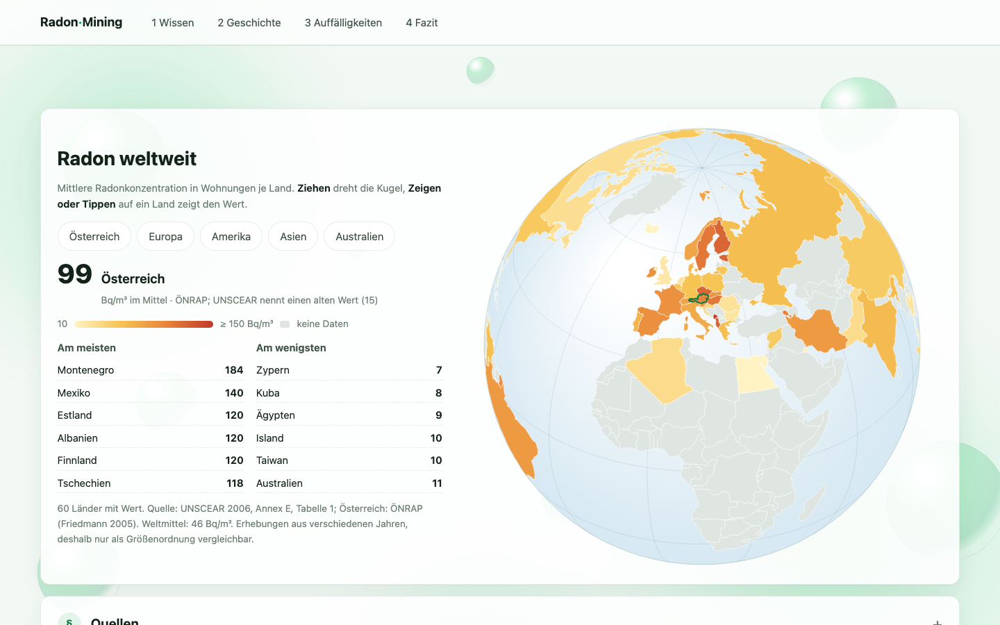

::: {.callout-tip appearance="simple"}
**Zur Website:** [aldin-122.github.io/5AHITS-INSY-Radon](https://aldin-122.github.io/5AHITS-INSY-Radon/radon.html) · **Code:** [github.com/aldin-122/5AHITS-INSY-Radon](https://github.com/aldin-122/5AHITS-INSY-Radon)
:::

## Worum es geht

In einem Einfamilienhaus in **Mining (Innviertel, OÖ)** hat eine kostenlose Messung von radon.gv.at zu viel Radon gezeigt. Der Besitzer hat danach
**sieben Sensoren** aufgestellt, zuerst mit **Lüften** gegengesteuert und schließlich eine **Lüftungsanlage** eingebaut. Wir hatten nur die Messdatei
(März bis Oktober 2026) und drei Hinweise: „Urlaub alles zu“, „KWL IBN“ (Inbetriebnahme der Lüftungsanlage) und „immer Fenster offen“.

Unsere Aufgabe: **erklären, was passiert, wie Radon ins Haus kommt, was hilft, ob man das in den Daten sieht**, und **jede Auffälligkeit** finden.
Das Ergebnis ist eine **interaktive Website** und diese Dokumentation.



## Rückblick

### Unsere Überlegungen am Anfang
- Wir wollten **zuerst verstehen, dann programmieren**. Deshalb haben wir mit der KI (Claude Code) einen **Plan in Phasen** gemacht und nach jeder Phase abgestimmt.
- Die Regeln für die Zusammenarbeit haben wir in einer Projektdatei festgehalten: bei Unklarheiten **nachfragen**, **alles testen**, jede Entscheidung **dokumentieren**.
  Das war eine Lehre aus dem letzten Projekt, wo ein Missverständnis die meiste Zeit gekostet hat.
- Weil wir große Fans von Visualisierungen sind, war schnell klar: Das Ergebnis soll eine **Website** sein, nicht nur ein paar Diagramme.

### Der Start
- Der erste Plan hatte **7 Phasen**. Das war uns zu langsam, deshalb haben wir ihn auf **3 Phasen** gekürzt: Analyse, Website, Doku und Abgabe.
- Die Datei war schwieriger als gedacht: Jede Zeile enthält nur den Wert **eines** Sensors, Sensoren starten neu und melden dann zuerst Nullen.
  Bevor man irgendetwas auswerten konnte, musste die KI die Daten **aufbereiten und bereinigen**.
- Die Zeiträume (Urlaub, „Fenster offen“, Lüftungsanlage) haben wir **nicht von Hand eingetragen**, sondern das Programm **selbst aus den Daten erkennen** lassen,
  zum Beispiel den Urlaub daran, dass das CO₂ nicht mehr steigt, weil niemand atmet.

### Was schnell ging
- **Recherche** zu Radon (Gesundheit, Grenzwerte, Boden, Messung) mit Quellen: in einem Schritt.
- Die **erste Website** mit allen Teilen (Wissen, Geschichte, 31 Auffälligkeiten, Fazit) inklusive Tests.
- **Kleine Wünsche** wie die Uhrzeit im Tooltip oder zugeklappte Fragen waren in Minuten umgesetzt.

### Was nicht so schnell ging
- **Die Regel für „Fenster offen“** hat mehrere Anläufe gebraucht, weil der Urlaub und ein paar kühle Nächte den Zeitraum zerteilt haben.
- **Der Einfluss des Windes:** Zuerst sah es so aus, als würde Wind das Radon stark senken. Mit allen Daten war der Effekt weg, denn die windigen Tage Ende März
  waren auch die kältesten. Erst eine **Regression**, die die Temperatur herausrechnet, hat das richtige (kleine) Ergebnis gezeigt.
- **Die Länderwerte für die Weltkugel:** Die offiziellen WHO-PDFs ließen sich nicht laden. Die vollständige Tabelle kam schließlich aus einem UN-Bericht (UNSCEAR 2006).
- **Die alte Sitzung war weg:** Claude Code löscht Gesprächsverläufe nach rund 30 Tagen. Weil wir aber alles in Plan, Doku und Prompt-Liste festgehalten hatten,
  konnten wir ohne Verlust weitermachen. Nur Zeit und Tokens der ersten fünf Prompts fehlen.

### Wo wir nachgebessert haben
- **Rückmeldung vom Hausbesitzer** eingearbeitet: Den 20.07. hatten wir als „Tag mit geschlossenen Fenstern“ gedeutet, sein Tipp war der **Dunstabzug**.
  Nachgerechnet passt das: Ohne Kamineffekt strömte **doppelt so viel Radon** nach wie im Urlaub. Außerdem: gelüftet wurde **von Anfang an**, auch das zeigen die Daten.
- **Design:** von dunkel auf **hell mit grünen Blasen** umgestellt.
- **Lisas Recherche** mit unserer verglichen: Das meiste passte, ergänzt haben wir Rechtslage, Förderung und Messarten. Einen Fehler haben wir korrigiert:
  Eine reine **Abluftanlage** hält Radon nicht fern, sie erzeugt Unterdruck und saugt **mehr** an.
- **Fazit** gekürzt und auf den Punkt gebracht, mit Zahlen statt langer Texte. Dazu kommt eine Erklärung, **warum 300 Bq/m³ schlimmer als 100** sind.

{width=70%}

## Die wichtigsten Ergebnisse

| Frage | Antwort |
|---|---|
| **Wie schlimm?** | Ø **43 Bq/m³** in den Wohnräumen (unter WHO 100). Ganz ohne Lüften pendelt sich das Haus aber bei **≈ 360** ein, also **über 300**. |
| **Wie dicht ist das Haus?** | Nur **2–4 %** der Luft werden pro Stunde getauscht (gemessen im Urlaub mit CO₂ **und** Radon). Empfohlen sind 30–50 %. |
| **Hilft Lüften?** | **Ja, aber nur für Stunden:** 2 h danach −58 %, nachts steigt es wieder auf das 3,5-Fache. |
| **Hilft die Lüftungsanlage?** | **Ja:** bei gleichen Bedingungen (Fenster zu, gleiche Außentemperatur) **−50 %**, der Keller bleibt dauerhaft unter 100. |
| **Warum schwankt es?** | **Kamineffekt:** je kälter draußen, desto mehr Sog von unten. Sommer ≈ 0,4 Pa, Winter ≈ 4 Pa. In der Heizzeit 5,7-mal so viel wie im Sommer. |
| **Auffälligkeiten** | **31** gefunden und erklärt: 16 zum Verhalten (Lüften, Urlaub, Dunstabzug …), 7 zum Haus (Räume, Stockwerke), 8 zur Datenqualität. |
| **Offen** | Der plötzliche Abfall am **31.03.** und der **Winter** (nicht gemessen). |



{width=80%}

## Die Website

Eine **einzige Datei** ohne Server, die auch offline funktioniert. Alle Diagramme sind **selbst gezeichnet** (SVG/Canvas), es gibt keine Bibliotheken.

1. **Wissen:** 12 Fragen zum Aufklappen (Was ist Radon? Warum die Lunge? Wie kommt es ins Haus? 100 oder 300?) und eine **drehbare Weltkugel** mit Radonwerten aus 60 Ländern
2. **Geschichte:** Gesamtverlauf mit Zoom, 5 Kapitel und ein **Radon-Rechner**
3. **Auffälligkeiten:** 31 Karten. Ein Klick zeigt die Stelle in der „Lupe“.
4. **Fazit:** 6 Antworten auf den Punkt





## Technik

::: {.callout-note collapse="true"}
## Daten und Bereinigung
- `radon_sample_data.csv`: 229 403 Zeilen, 24.03.–13.10.2026, „langes“ Format (eine Zeile = ein Sensor).
- 7 Radon-Sensoren, Raumklima (CO₂, Temperatur, Druck, Feuchte) in Küche und Schlafzimmer, Wetter stündlich.
- **Bereinigung:** die erste Stunde nach jedem Neustart verworfen (428 Werte), CO₂ unter 350 ppm entfernt, 62 doppelte Meldungen entfernt.
- Danach wurden die Werte auf ein **10-Minuten- und ein 1-Stunden-Raster** gemittelt.
:::

::: {.callout-note collapse="true"}
## Methoden
- **Zeiträume erkennen:** Urlaub = längste Zeit ohne CO₂-Anstieg; „Fenster offen“ = Nächte, in denen das CO₂ im Schlafzimmer kaum steigt; Lüftungsanlage = ab wann der Keller nie mehr über 100 liegt.
- **Urlaub als Experiment:** C(t) = C_gl + (C₀ − C_gl)·e^(−(n+λ)t) liefert Luftwechsel n, Gleichgewicht und Zustrom. CO₂ und Radon ergeben unabhängig voneinander denselben Luftwechsel.
- **Dunstabzug-Tag:** dieselbe Rechnung für einen einzelnen Tag; Zustrom = Anstieg + n·C.
- **Kamineffekt-Druck:** Δp = g·h·(ρ_außen − ρ_innen), ρ = p/(R·T), Höhe 4,8 m (aus dem Druckunterschied zwischen Küche und Schlafzimmer).
- **Fairer Vorher/Nachher-Vergleich:** nur Nächte mit sicher geschlossenem Fenster, gruppiert nach Außentemperatur.
- **Mehrfache Regression** (Radon ~ Temperaturunterschied + Wind + Druckänderung), damit sich Wettergrößen nicht gegenseitig vortäuschen.
:::

::: {.callout-note collapse="true"}
## Aufbau des Codes
| Datei | Aufgabe |
|---|---|
| `daten.py` | CSV einlesen, prüfen (fehlende/leere/kaputte Datei), bereinigen, Zeitraster |
| `analyse.py` | alle Auswertungen → `ergebnisse/ergebnisse.json` |
| `diagramme.py` | 10 PNG-Diagramme für die Doku |
| `auffaelligkeiten.py` | die 31 Auffälligkeiten als Daten, Zahlen aus der Analyse |
| `radon_laender.py`, `welt/` | Länderwerte (UNSCEAR 2006, Österreich ÖNRAP) und Ländergrenzen für die Weltkugel |
| `webseite.py` + `webseite_vorlage.html` | bauen `radon.html` (Daten als JSON in die Vorlage) |
| `test_analyse.py` | 20 Tests |
:::

::: {.callout-note collapse="true"}
## Tests
- **20 Python-Tests:** Fehlerfälle (Datei fehlt, leer, falsche Spalten, Binärdatei, kaputte Werte), Bereinigungsregeln, Ende-zu-Ende mit echten Daten,
  ein Mittelwert von Hand nachgerechnet, Dunstabzug, Fazit-Zahlen, Weltkugel-Daten, Website-Erzeugung.
- **34 Browser-Prüfungen** (`radon.html?test`): alle Diagramme gezeichnet, Tooltip mit Uhrzeit, Weltkugel dreht sich, alle 31 Auffälligkeiten in der Lupe,
  keine JavaScript-Fehler, kein waagrechtes Scrollen, jeweils bei **1440 × 900** und **390 px** (Handy).
- Zum Schluss **aus einem frischen Klon** des Repos und **auf der Live-Seite** getestet.
:::

::: {.callout-note collapse="true"}
## Entscheidungen (Problem → Lösung)
- **Erste Stunde nach Neustart verwerfen**, nicht nur die Nullen: Auch danach springen die Werte noch stark.
- **Gesamtdiagramm:** Stundenwerte über 7 Monate waren zu unruhig → je nach Zoom 3-/6-/12-/24-Stunden-Mittel; der Tooltip zeigt trotzdem den Stundenwert mit Uhrzeit.
- **Wind:** einfacher Vergleich irreführend → Regression mit herausgerechneter Temperatur.
- **Helles Design**, gestrichelte Grenzwert-Linien (sonst mit dem gelben Sensor verwechselbar), Wissens-Fragen zugeklappt.
- **Österreich auf der Weltkugel:** Der UNSCEAR-Wert (15 Bq/m³) stammt aus sehr wenigen Messungen, deshalb verwenden wir das Ergebnis der österreichischen Erhebung ÖNRAP (99 Bq/m³).
- Ausführlich in `DOKUMENTATION.md` im Repo.
:::

::: {.callout-note collapse="true"}
## Anleitung
```bash
git clone https://github.com/aldin-122/5AHITS-INSY-Radon.git
cd 5AHITS-INSY-Radon
python3 analyse.py      # Auswertung → ergebnisse/ergebnisse.json
python3 diagramme.py    # Diagramme → diagramme/
python3 webseite.py     # Website → radon.html, öffnet sich im Browser
python3 -m unittest -v test_analyse
```
Benötigt: Python 3 mit pandas, numpy, scipy und matplotlib.
:::

## Arbeit mit der KI

Wir haben das Projekt mit **Claude Code** umgesetzt („Vibe Coding“). Wir haben erklärt, entschieden, geprüft und Rückmeldungen gegeben.
Die KI hat programmiert, recherchiert, getestet und dokumentiert. Alle Prompts mit Ergebnis, Zeit und Tokens stehen in `PROMPTS.md`.

- **Was gut funktioniert hat:** Phasen mit Abstimmung, Rückfragen der KI bei Unklarheiten, Tests mit Screenshots, alles laufend dokumentiert.
- **Worauf man achten muss:** Die KI deutet Daten manchmal plausibel, aber falsch (20.07.). Hier hat erst das Wissen des Hausbesitzers geholfen.
  Fakten aus dem Internet haben wir prüfen lassen und Quellen verlangt.
- **Zeit und Tokens:** Prompts 6–11 laut Gesprächsverlauf, für 1–5 nicht mehr verfügbar (Verlauf automatisch gelöscht).

## Quellen
radon.gv.at · Bundesamt für Strahlenschutz · WHO (2009) · Darby et al. 2005 (BMJ) · Krewski et al. 2005 (Epidemiology) · UNSCEAR 2006 Annex E ·
Friedmann 2005 (ÖNRAP) · Land OÖ (Radongebiete, Förderung) · WKO · USGS · world-atlas / Natural Earth. Vollständige Liste mit Links: `RECHERCHE.md` und auf der Website.
